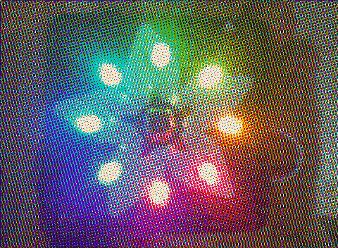

# halftone-camera

Adafruit Memento halftone camera.

## Controls

### Camera mode

- `up`: Change LED brightness
- `down`: Toggle black and white filter
- `left`: Change LED color
- `right`: Change halftone shape
- `select`: See camera roll (TODO)
- `ok`: See camera settings (TODO)
- `shutter_long`: Autofocus
- `shutter_short`: Take photo

### View mode

- `ok`: Save photo to SD card
- `up` / `down` / `left` / `right`: Scroll
